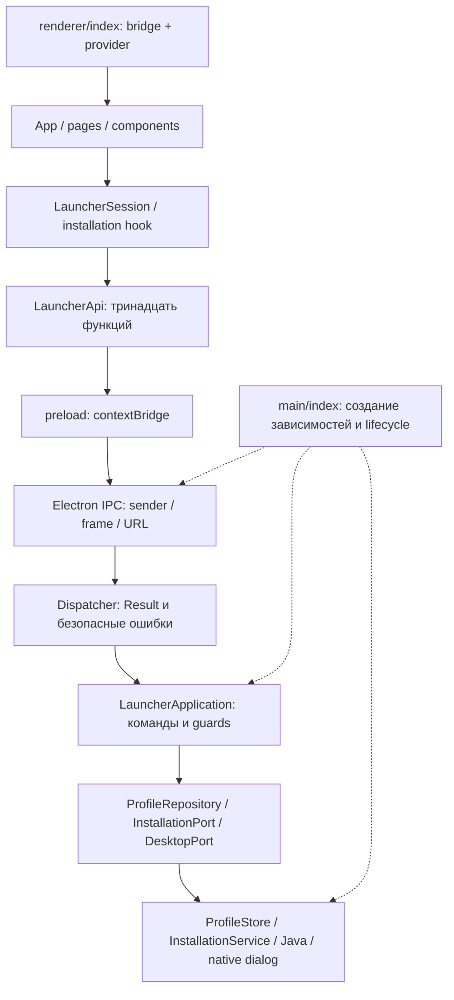

# Архитектура Space Launcher

Срез на 23 октября 2026. Рефакторинг касается `apps/launcher`; сайт Next.js/NestJS и игровой мод остаются отдельными приложениями монорепозитория. Лаунчер разделён на прикладные команды, адаптеры Electron, инфраструктуру и представление. Новые библиотеки для этого не потребовались.

## Поток команды

`main/index.ts` — точка сборки зависимостей. Здесь выбираются реальные реализации хранилища, установки, Java и desktop-функций, создаётся окно и регистрируется протокол. Реестра сервисов, глобального контейнера зависимостей и дополнительных процессов нет.

## Владение модулями

| Каталог | Ответственность | Допустимые зависимости |
| --- | --- | --- |
| `shared/models.ts`, `shared/installation.ts` | Данные профилей, результатов и установки | Только `shared` |
| `shared/ipc.ts` | Каналы, входы, выходы, производный `LauncherApi` | Только `shared` |
| `main/application` | Тринадцать команд, порты, guards Java, обработка результата | `application`, `shared`; без Electron, Node и конкретных хранилищ |
| `main/electron` | Окно, native picker, shell, IPC и локальные assets | Прикладные интерфейсы, Electron и Node по назначению адаптера |
| Остальные модули `main` | Файлы, очередь загрузок, проверка JAR, natives, auth vault/callback | Node, прикладные контракты, локальные инфраструктурные модули; без Electron, кроме точки сборки и адаптеров |
| `preload.ts` | Тринадцать явно перечисленных функций | Electron и `shared` |
| `renderer/model` | Состояние профилей, черновик, ошибки, взаимное исключение команд | Модель и `shared`; без React, DOM и платформенных API |
| `renderer/hooks` | Подключение модели к React, контекст API, polling установки | React, модель, типизированный API |
| `renderer/pages`, `components` | Разметка, отображение и пользовательские события | Renderer и общие типы; без Node/Electron |

`shared/contracts.ts` сохранён как совместимый экспорт типов. Типы транспорта не заменяют runtime-валидацию: вход каждого main-обработчика остаётся `unknown`, а ID, поля, память и пути проверяются существующими валидаторами. Модель renderer отвечает за удобство взаимодействия; полномочия и запись принадлежат main.

## Состояние интерфейса

`LauncherSession` получает `LauncherApi` через конструктор и предоставляет стабильный `getSnapshot` и подписку для `useSyncExternalStore`. Только `renderer/index.tsx` читает `window.space`; страницы получают готовую модель, а контекст позволяет подставить другой API при проверках.

Снимок из main копируется перед применением. Активный профиль, dirty-флаг и подпись Java вычисляются в одном месте. Черновик переживает переключение разделов. До save/cancel нельзя сменить профиль, создать новый, повторно загрузить настройки или выбрать Java; нажатие на уже активный профиль сохраняет черновик. На время команды блокируются повторные команды и редактирование, а неуспешное сохранение оставляет введённые значения. Проверка Java хранится по ID профиля.

Установка остаётся отдельным workflow: `InstallationService` владеет глобальной задачей, отменой и завершением записи; `useInstallation` опрашивает статус, `InstallationCard` отображает его. Размонтирование карточки прекращает polling, но не отменяет установку в main. Закрытие приложения ждёт отмены активной установки. Базовая подготовка, кеш natives и собственный JAR сохраняют существующие проверки целостности и отдельные тесты.

## Граница ошибок и привилегий

- `UserFacingError` помечает намеренные, безопасные для пользователя сообщения. Dispatcher возвращает их в `Result`; неизвестные исключения заменяет фиксированной фразой. Аналогичная фильтрация применяется к `InstallationStatus.message`, поскольку установка завершается асинхронно после ответа IPC. `cause`, stack и исходные OS/SDK-сообщения в DTO не входят.
- Ошибки загрузок и проверки файлов содержат фиксированный текст; `DownloadFailure` сохраняет отдельный признак retryable. Тип ошибки не меняет правила повторов, проверки хеша или атомарной записи.
- Native picker передаёт путь только внутри main. Renderer передаёт ID и разрешённые настройки. Shell получает путь от repository, а не произвольный путь из UI.
- Проверки точных webContents/mainFrame/URL, sandbox/contextIsolation, CSP, запреты окон, навигации и permissions сохранены. IPC-обработчики снимаются при закрытии окна и частичной ошибке регистрации.
- Auth vault/callback ещё не подключены к UI. Для них действуют отдельные правила [AUTH.md](AUTH.md): токены, codes, claims, кеш и raw SDK errors не передаются в renderer.

## Правила расширения

1. Новую команду описать в `shared/ipc.ts`, явно добавить в preload и реализовать в `LauncherApplication` с проверкой `unknown` на main-стороне.
2. Внешнюю возможность представить небольшим портом в `application/ports.ts`; реализацию подключить в `main/index.ts`. Прикладной слой не импортирует конкретный Electron API или инфраструктурный сервис.
3. Общее состояние и правила переходов держать в модели; React-компонентам оставлять отображение и события. Polling и подписки должны иметь cleanup.
4. Добавить проверку полезного поведения: ошибки, повтор команды, сохранность данных, ограничения привилегий. TypeScript проверяет соответствие контракта, `architecture.test.cjs` — направления импортов и отсутствие runtime-циклов.
5. Выполнить launcher tests, typecheck, build и изолированную UI-проверку. Изменение границ требует обновления этого документа и `apps/launcher/AGENTS.md`.

Для Microsoft-входа следующим отдельным модулем станет прикладной workflow с портом авторизации и безопасным статусом аккаунта. Локальный запуск SC-25 добавляет LaunchPort/LaunchService и main-owned prepareLocalLaunch: повторная проверка установки/runtime, один процесс на профиль, безопасный статус и журнал. Команды local:save / launch:get / launch:start увеличивают bridge до 13 функций. Прикладной слой исключает установку и запуск друг с другом; порт процесса резервирует профиль до первого await и освобождает только после close. Официальный онлайн-вход по-прежнему требует проверки владения/авторизации. Детали — [LOCAL-LAUNCH.md](LOCAL-LAUNCH.md).

## Проверено

- 92 launcher tests: существующие 76 и 16 новых проверок команд, статических границ, renderer-модели и фильтрации ошибок установки.
- TypeScript и build main/preload/renderer с проверенным development JAR проходят.
- Изолированный Electron: три экрана × четыре viewport, сохранение профилей на диск, RAM с клавиатуры, dirty guards, отсутствие Node globals и ошибок renderer/CSP. Снимок обзора осмотрен. Отчёт: [launcher-architecture-2026-10-23.json](qa/launcher-architecture-2026-10-23.json).
- Эта проверка не использует настоящий аккаунт, загрузку игровых файлов или native picker. Рефакторинг не реализует Microsoft-вход, владение игрой и запуск.
