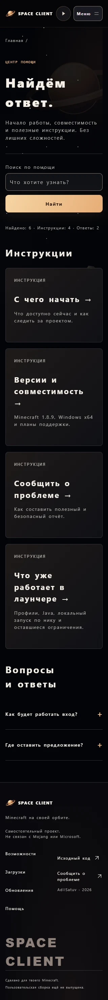
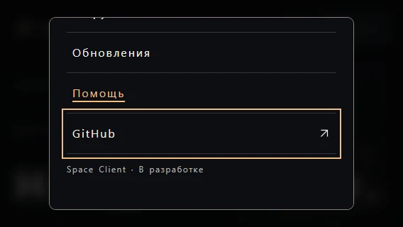

# Локальная визуальная проверка и интервалы текста

Срез SC-23 от 24 октября 2026, окончательный Eclipse / Ringworld. [Сводный отчёт и hashes](qa/website-accessibility-2026-10-24.json), полная регрессия [Chrome](qa/website-accessibility-chrome-2026-10-24.json) / [Firefox](qa/website-accessibility-firefox-2026-10-24.json). Это локальный production build, не публичная приёмка.

## Найдено и исправлено

При пользовательских интервалах текста шапка становилась тесной, а декоративная подпись SPACE CLIENT в подвале выходила за страницу. В отдельном оконном Chrome при viewport 320 px доступная ширина была 305 px, scrollWidth — 372 px; при 1440 px — 1425/1742 px. Прежний nowrap не позволял подписи переноситься. Аналогично тесные колонки подвала могли выталкивать длинные ссылки.

Шапка и desktop navigation допускают перенос, подпись подвала переносится по словам и при необходимости внутри слова, ссылки — внутри своих колонок. Колонки mobile footer получили minmax(0, 1fr). Размер большой desktop-подписи немного уменьшен: обычный вид сохраняет одну строку, увеличенные интервалы могут дать две. Горизонтальный overflow не маскируется на body.

При визуальном чтении обнаружены устаревшие сведения после SC-03/04/05/25. Текущие главная, каталог и помощь теперь описывают проверенный локальный запуск по нику и редактор HUD. Добавлена новая заметка `/updates/local-launch-and-hud`; старые записи сохранены как датированная история. Сайт по-прежнему не обещает FPS-прирост, публичный установщик, Space-регистрацию или официальный онлайн-вход.

## Что действительно проверено

- **26 полных снимков Chrome:** 13 маршрутов × 390/1440 px. Осмотрены главная, каталог, пустые загрузки, список и все три статьи обновлений, помощь и все четыре инструкции, настоящий 404. Снимки разбиты на последовательные панели для чтения, включая нижние части страниц. Это проверка текущего сайта, не синхронизация или приёмка Figma.
- **WEB-TEXT-SPACING в Chrome и Firefox:** восемь маршрутов × 320/761/1440 px. Использованы четыре значения [W3C SC 1.4.12](https://www.w3.org/WAI/WCAG22/Understanding/text-spacing): line-height 1.5, paragraph spacing 2em, letter-spacing 0.12em, word-spacing 0.16em. Нет горизонтальной прокрутки страницы, выхода header controls за экран и обнаруженного горизонтального обрезания текстовых ranges в overflow:hidden/clip. Это ограниченная геометрическая проверка, не полный аудит всех способов потери содержимого.
- **WEB-SHORT-MENU в обоих движках:** 568×320 и 320×568 с теми же интервалами. Enter открывает dialog; шесть остановок Tab остаются внутри и видимы после внутренней прокрутки. Проверены forward/reverse loop, Escape и возврат фокуса к trigger. Снимок landscape с выделенным последним пунктом осмотрен.
- Дополнительный оконный Chrome с обычной полосой прокрутки: помощь на 320/390/761/1024/1440 px после исправления имеет scrollWidth, равный clientWidth. Это отдельная проверка от headless-профиля.
- После изменений общего CSS выполнена полная регрессия: Chrome **42 layouts / 27 flows**, Firefox **42 / 26**, включая прежние no-JS, motion, API-failure/retry и browser-specific checks. Page errors и неуспешные собственные assets в отчётах отсутствуют. Новые два flow входят в обычные browser CI jobs.
- Production build, **149 тестов** (32 root / 9 API / 108 launcher), TypeScript, 46 tokens / 20 contrast pairs, format и восемь HTTP state fixtures прошли. Отдельный route smoke проверил 12 HTTP 200 маршрутов, head metadata, filters и HTTP 404.





## Assistive technology: пункт открыт

Настоящий Windows Narrator был запущен. Его окно вернуло `Accessibility is limited because the target window has higher Windows integrity than the Computer Use helper`. Получить проверяемый speech recap не удалось. Затем native Computer Use остановился из-за невозможности надёжно определить URL нового окна Chrome; в том turn ввод был прекращён. В следующем turn источник Chrome для Browser Use также оказался недоступен. Эти ограничения не считаются дефектами сайта.

Ни чтение заголовков/landmarks, ни озвучивание меню, результатов поиска, pending/retry и clipboard-сообщений **не приняты**. DOM, keyboard automation и Lighthouse не заменяют screen reader. Narrator при финальной проверке уже отсутствовал среди процессов. Глобальные параметры Windows/браузера не менялись; браузерные проверки использовали собственные QA-профили. Повышать права helper или устанавливать новый screen reader ради обхода ограничения не стали.

Для закрытия ручного пункта нужен проверяемый проход с настоящим screen reader: порядок landmarks/headings, имена и состояния controls, dialog/возврат фокуса, поиск и результаты, FAQ, переходы, ошибки/retry и clipboard success/denial. Для каждого сценария записать версию AT/браузера и фактически произнесённые сообщения; недоступный пункт оставить открытым.

## Повторение и границы

После штатного `npm.cmd run preview:web`:

```powershell
node scripts/check-website-accessibility.cjs
node scripts/check-website-accessibility.cjs --firefox
```

Команда берёт loopback origin из `.reports/local-preview.json`; `SPACE_SITE_URL` может указать другой локальный QA-preview. Профиль, PNG и report.json сохраняются в уникальном игнорируемом `.reports/website-accessibility/run-*`. Chrome можно задать через SPACE_CHROME_PATH; Firefox закреплён существующим setup. Для полной регрессии — `npm.cmd run check:web:browser` и `npm.cmd run check:web:firefox`.

Safari, ручное AT и полная окончательная приёмка остаются открытыми. Lighthouse не повторялся: прежние 15 прогонов относятся к предыдущему исходному коду и остаются историческим локальным baseline. Production HTTPS/SEO, hosting и rollback отложены пользователем; noindex сохранён. SC-23 и SC-17 этим срезом не закрываются.
