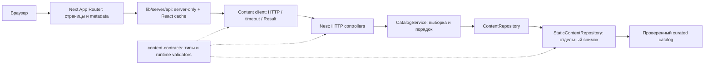

# Архитектура вебсайта Space Client

Срез на 24 октября 2026. Текущий приоритет пользователя — архитектура Next.js + NestJS. Публичный сайт остаётся контентным и доступным без аккаунта. Собственная регистрация Space в лаунчере и временный вход по нику выбраны как последующее направление; в этом срезе аккаунты, пароли, сессии и запуск игры не реализуются. Microsoft-вход отложен, ранее подготовленный код лаунчера сохранён.

## Поток данных



Сайт и API остаются двумя Node.js-процессами одного monorepo. Браузер обращается к Next; приватный origin API читается только на сервере. Микросервисы, база, CMS, глобальный state manager и новые внешние зависимости для этого разделения не добавлены.

## Общий контракт

`packages/content-contracts` — приватный workspace `@space/content-contracts` версии 0.1.0. Он содержит Feature/Release/Artifact/Update/ProjectStatus, перечисления, правила slug/query, размер страницы журнала и runtime validators. Исходники компилируются в CommonJS и declarations; публичный импорт пакета ограничен корневым entry point. Пакет не зависит от Next, Nest, React, диска или приложений.

Проверка формы данных общая для производителя и потребителя. `validateContent` дополнительно проверяет весь каталог: уникальность id/slug, существование releaseId, связь релиза с его changelog и отсутствие дубликата артефакта платформы. Веб-клиент проверяет отдельный ответ, а также совпадение запрошенных slug, страницы и типа записей. Публичный HTTP API остаётся `/v1`; формы существующих ответов не изменились.

Пустой `releases: []` — допустимые данные. Некорректный каталог останавливает bootstrap API, а не частично публикуется. Новые поля и семантику контракта менять сначала в общем пакете и тестах совместимости, затем в двух потребителях. Этот пакет описывает публичный контент; учётные записи, игровые токены и Electron IPC сюда не относятся.

## NestJS

| Модуль | Ответственность |
| --- | --- |
| `app.module.ts` | Собрать feature modules и выбрать production-каталог либо явно переданный тестовый снимок |
| `project.controller.ts` | Health и информация о проекте |
| `content/content.module.ts` | Связать repository, сервис и HTTP-контроллер через providers |
| `content/http` | Проверить query/slug, перевести отсутствие статьи в 404, вызвать сервис |
| `content/application` | Порт хранилища и CatalogService: фильтрация, сортировка, пагинация, поиск |
| `content/infrastructure` | Versioned контент и его проверенное хранение в памяти |
| `api-errors.ts` | Безопасный HTTP envelope без stack/raw internal error |

Прикладной слой не импортирует Nest и HTTP. Controller не читает массивы production-каталога и не выполняет сортировку. Связывание через feature module и factory providers соответствует [модулям Nest](https://docs.nestjs.com/modules) и [custom providers](https://docs.nestjs.com/fundamentals/custom-providers).

`StaticContentRepository` проверяет и копирует вход при создании; чтение возвращает отдельный снимок. Поэтому изменение fixture после bootstrap или результата сервиса не меняет работающий каталог. Тесты создают `createApp({ catalog })`; параметр доступен только коду сборки приложения, публичного fixture endpoint/env нет. Два экземпляра API могут работать с разными каталогами в одном процессе.

## Next.js

- `app` владеет маршрутом, metadata, loading/error/not-found и композицией UI. Большинство страниц — Server Components; интерактивные островки остаются в `components`.
- `lib/server/api.ts` — единственная точка чтения `SPACE_API_URL` для контента, с `import 'server-only'`. React cache согласует чтение между metadata и страницей в рамках render-запроса; межпользовательского кеша данных нет.
- `lib/server/content-client.ts` — проверяемый без Next транспорт с подстановкой fetch. Он предоставляет конкретные методы, а не произвольный URL из браузера.
- `lib/queries.ts` — нормализация URL журнала, общая для страницы и metadata. Браузерные некорректные значения получают безопасные defaults; HTTP API намеренно отвечает 400 на некорректный запрос.
- `lib/catalog.ts` — чистый выбор рекомендуемого релиза. Stable предпочтителен, отозванные и несовместимые версии исключаются. Это правило представления сайта, поэтому оно не перенесено в транспортный контракт.
- `lib/content.ts` — локальная помощь и подписи; не является хранилищем релизов. `lib/metadata.ts` управляет preview/noindex/canonical.

Существующие Server/Client conventions проверены по руководствам установленного Next.js 16.4.2 в `node_modules/next/dist/docs/01-app/01-getting-started/05-server-and-client-components.md` и `06-fetching-data.md`. Не переносить server adapter в Client Component ради удобства.

## Сеть и ошибки

Transport принимает HTTP/HTTPS-origin без credentials/path/query/hash из серверной конфигурации. Он использует фиксированный префикс `/v1`, `no-store`, таймаут 2500 мс, `redirect: error` и не выполняет автоматические повторы. Таймаут действует и во время чтения тела. Принимается JSON; объявленный размер и поток ограничены 1 МиБ. Тело освобождается при ошибке или превышении лимита.

Результат — `ContentResult<T>`: данные либо `missing / invalid / unavailable`, без исходного исключения. Разделы сохраняют отдельные empty/error состояния. Некорректный slug статьи и настоящий 404 не становятся пустой статьёй или фиктивным 200. При росте полного каталога выше лимита нужно добавить пагинацию контракта; увеличивать лимит без измерения или обрезать ответ молча нельзя.

## Проверки и сборка

```powershell
npm.cmd ci
npm.cmd test
npm.cmd run build
npm.cmd run check:web:states
npm.cmd run check
npm.cmd run format:check
```

У API и сайта prebuild/predev/precheck сначала собирают общий пакет; root test также делает это до загрузки контрактных тестов. Ручная команда: `npm.cmd run build:contracts`. Генерируемый `packages/content-contracts/dist` не коммитится. Production размещение должно включать собранный пакет вместе с API/Next из одного commit; копирования только `apps/api/dist` недостаточно.

`tests/website-architecture.test.cjs` разбирает TypeScript AST и проверяет направления импортов, отсутствие runtime-циклов и транзитивных server-зависимостей у Client Components. Прямой fetch вне server adapter запрещён этой проверкой. Это защита от архитектурной регрессии, а не независимый аудит безопасности.

Локально прошли 117 тестов: 16 общих, 9 API и 92 launcher. Новые сценарии проверяют изоляцию каталогов, bootstrap, транспортные ошибки, лимиты, настоящий HTTP timeout, параметры запросов и граф зависимостей. Production state checks подтверждают empty/error, unsafe artifact, stable/prerelease/withdrawn, пагинацию и 404. В этом срезе не проводились новые визуальные измерения, Lighthouse или публикация сайта.

## Как расширять дальше

1. Для контентной возможности изменить контракт, добавить прикладную операцию, HTTP-адаптер и серверное чтение Next. Страницы не импортируют API infrastructure.
2. Для CMS/БД добавить реализацию ContentRepository с теми же гарантиями валидации и отделённых данных. API-сервис и страницы не должны узнавать устройство хранения.
3. Учётные записи Space вынести в отдельный feature module с собственной моделью, хранилищем и управлением сессиями. Не смешивать парольную регистрацию с JSON-каталогом и не считать один введённый ник проверкой личности.
4. После архитектурного среза продолжить приёмку SC-18/23 и подготовку размещения SC-24. Статусы задач не закрываются только по факту успешной сборки.
