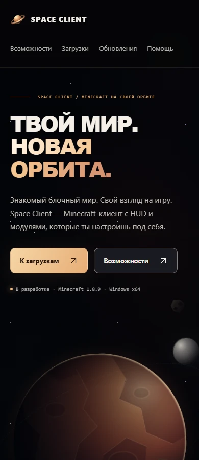
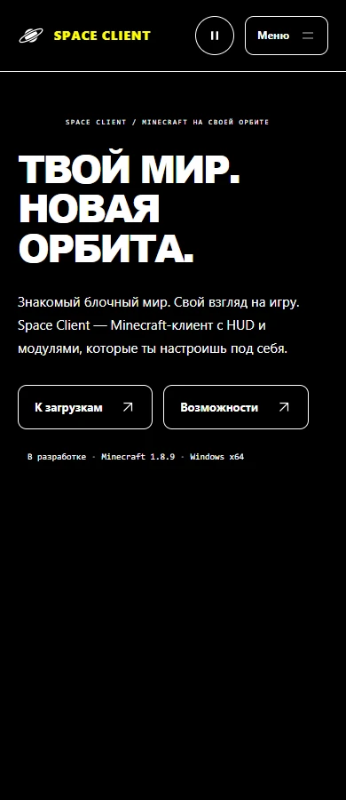

# Читаемый HTML и доступные режимы

Срез 24 октября 2026, SC-18/23. Проверки выполняются в отдельных headless-профилях Chrome и Firefox; настройки личных браузеров и Windows не меняются.

## Первый HTML

Выявлен реальный дефект: при выключенном JavaScript страницы с route loading boundary оставались на skeleton. Сервер присылал готовое содержимое в скрытом streamed-сегменте, перенос которого требовал React-скрипта.

Убраны четыре route loading adapter и неиспользуемый skeleton. Данные, query parsing, empty/error и 404 остаются серверными. Полный HTML динамического раздела ожидает ограниченный таймаутом ответ API. Это увеличивает ожидание первого ответа при медленном API, зато полученный документ сразу пригоден для чтения без скриптов.

Обычная GET-форма не перехватывается. Навигация через общий SiteLink использует Next Link и его [useLinkStatus](https://nextjs.org/docs/app/api-reference/functions/use-link-status): старое содержимое остаётся на экране до ответа; на нажатой ссылке появляется индикатор с live status. Индикатор расположен абсолютно и не меняет размеры ссылки. Предзагрузка и поведение истории Next сохранены.

WEB-PENDING проверяет настоящую client navigation с задержкой API 1200 мс: прежний h1 остаётся видимым, размеры ссылки не меняются, pending исчезает после открытия каталога.

## Выключенный JavaScript

CSS [scripting: none](https://developer.mozilla.org/en-US/docs/Web/CSS/Reference/At-rules/@media/scripting) показывает существующие ссылки header на всех ширинах и скрывает неработающие кнопки диалога/анимации. Сцена остаётся статичной по серверному data-motion=paused.

WEB-NO-JS проверяет:

- 320/390/1440 px: все четыре ссылки видны, нет horizontal overflow и неработающих menu/motion buttons;
- уникальные ID градиентов Ringworld в нескольких экземплярах;
- обычную отправку поиска возможностей и помощи, результат CPS и ответ о входе;
- раскрытие карточки/FAQ с Enter;
- отсутствие публичного установщика, пустой release-фильтр и настоящий HTTP 404.

Chrome отключает выполнение JavaScript до первой навигации. Закреплённый Firefox не поддерживает BiDi emulation.setScriptingEnabled, поэтому отдельный профиль использует javascript.enabled=false; matchMedia подтверждает scripting:none. Профили запускаются последовательно. Pointer submit использует наблюдённые bounds кнопки и синхронный scroll: в таком Firefox-профиле callback IntersectionObserver из стандартного ElementHandle.click не выполняется. DOM-чтения остаются синхронными.

Это проверка перечисленных базовых сценариев при полном отключении скриптов. Она не объявляет работу clipboard, refresh-in-place или любой частичной блокировки bundles браузерными расширениями без JavaScript.

## Высокая контрастность

В forced-colors:active градиентный заголовок получает CanvasText вместо прозрачной заливки; фоновые декорации скрываются, кнопки используют ButtonFace/ButtonText, focus — Highlight, текущая ссылка сохраняет подчёркивание. Объёмный Ringworld переключается на плоский силуэт с системными цветами.

WEB-FORCED-COLORS проверяет в Chrome CDP тёмную и светлую схему на 390/1440 px, видимый заголовок, SVG fallback, отсутствие overflow и контур клавиатурного focus. Это эмуляция CSS media features, а не ручная проверка конкретной темы Windows Contrast. Firefox проходит no-JavaScript и обычную матрицу; forced-colors этим Gecko-набором не проверяются.

## Отчёты

- [Chrome: 42 layouts / 25 сценариев](qa/website-resilience-chrome-2026-10-24.json)
- [Firefox: 42 layouts / 24 сценария](qa/website-resilience-firefox-2026-10-24.json)
- [Lighthouse: 15 прогонов пяти страниц](qa/website-resilience-lighthouse-2026-10-24.json): медианы Performance 99 / Accessibility 100 / CLS 0, LCP 2048–2196 мс.
- Команды: npm run check:web:browser и npm run check:web:firefox.

SC-23 остаётся открытой для полной ручной визуальной приёмки, assistive technology и production HTTPS/SEO. Публичное размещение по-прежнему отложено пользователем.

Следующий локальный срез: [WEB-ACCESSIBILITY.md](WEB-ACCESSIBILITY.md). В текущем Eclipse осмотрены 26 снимков, исправлен overflow при увеличенных интервалах и проверено меню на коротком экране в двух движках. Ручное AT осталось открытым с записанной причиной; прежние Lighthouse-замеры выше не выдаются за замеры нового кода.
