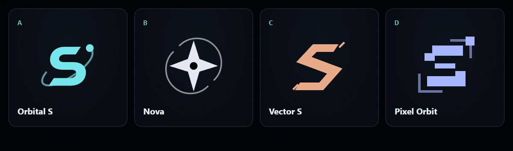
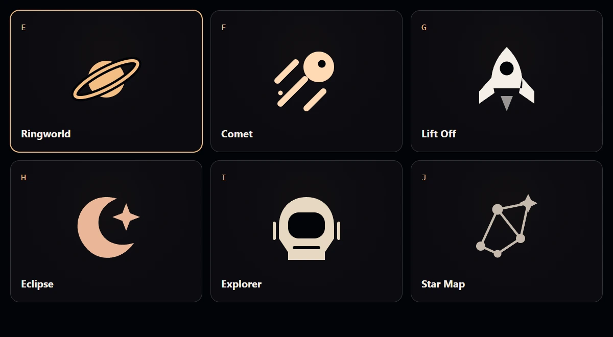
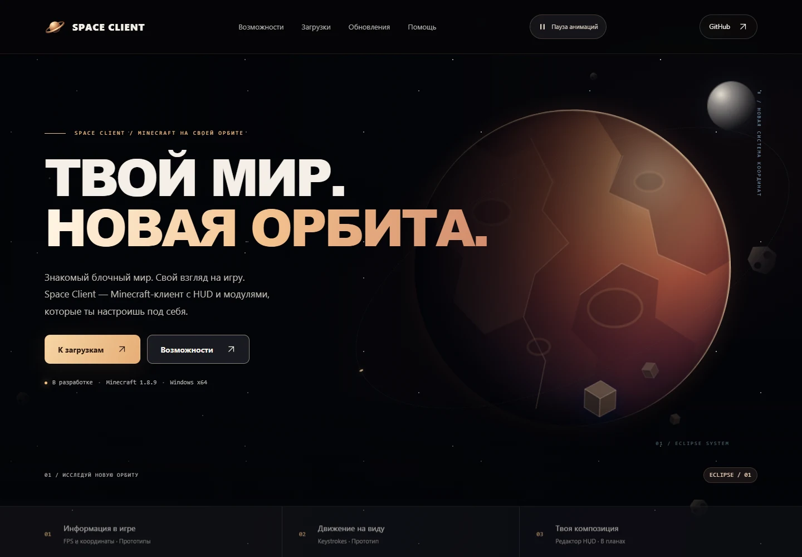
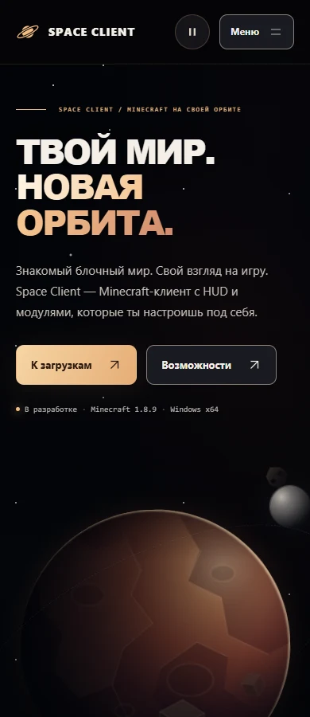

# Eclipse — визуальная система Space Client

Итерация 24 октября 2026 по запросу пользователя: почти чёрный звёздный фон, медно-терракотовая скалистая планета без колец, фоновые астероиды и тёплые элементы управления. Пользователь выбрал логотип **E — Ringworld**, он применён к сайту. Новые значения JSON **ещё не перенесены в Figma**: MCP Starter сообщил об исчерпании лимита; прежние Nebula-компоненты и FIG остаются историческими срезами.

## Палитра и композиция

| Роль | HEX |
|---|---|
| Основной фон | #030407 |
| Поверхность / приподнятая поверхность | #0D0E13 / #181920 |
| Основной текст / вторичный | #F4EFE7 / #B7B4AF |
| Янтарный / медный | #F4BD82 / #D09D80 |
| Контрастная граница элементов управления | #8B8079 |

Почти чёрный фон и три масштаба звёзд проходят через весь сайт; цветное фоновое свечение едва заметно. Янтарные кнопки, медный градиент заголовка и мягкий светлый текст согласованы с планетой: SVG-рельеф, кратеры и освещённый край вместо прежней голубой полосатой планеты с кольцами. По тонкой орбите движется огонёк. Фоновые камни дрейфуют медленно; редкая комета не пересекает основной блок действий. Системные Segoe UI / Arial Black и Consolas сохраняют кириллицу и не требуют загрузки шрифтов.

Главная: текст слева, планета с кольцами справа; на телефоне планета уходит под действия. Каталоги, статьи, формы, меню, footer и favicon используют ту же систему. Реальные статусы проекта и отсутствие публичного релиза сохранены.

## Ringworld — выбранный логотип

Планета с наклонённым кольцом, без буквы S. Пользователь выбрал E из второго раунда. Янтарный одноцветный силуэт на тёмном фоне; встроенный SVG наследует currentColor, зазор кольца использует фон темы. Favicon имеет тёмную подложку. Знак применяется в header, footer, декоративных watermark и HUD preview.

- [Чистый SVG-знак](../../apps/website/public/brand/space-mark.svg)
- [Горизонтальная подпись](../../apps/website/public/brand/space-wordmark.svg)
- [Favicon](../../apps/website/app/icon.svg)

Вариант с подписью использует системный шрифт SVG text; отдельный знак состоит из векторных контуров.

### Сохранённые варианты

Первый раунд: [витрина A–D](../../apps/website/public/brand/logo-concepts.html). Второй раунд без монограммы: [витрина E–J](../../apps/website/public/brand/cosmic-logo-concepts.html), в preview — /brand/cosmic-logo-concepts.html. Доступны цвет/монохром, размеры 144/32/20/16 px, подпись и скачивание SVG. E отмечен как выбранный. Кнопки только отмечают эскиз в открытой витрине; сайт не переключают автоматически.

| Буква | Направление | SVG |
|---|---|---|
| A | Orbital S — первая орбитальная монограмма | [Знак](../../apps/website/public/brand/space-mark-orbital-s.svg) |
| B | Nova — минималистичная звезда-компас | [Знак](../../apps/website/public/brand/space-mark-nova.svg) |
| C | Vector S — угловатая геометрия и скорость | [Знак](../../apps/website/public/brand/space-mark-vector.svg) |
| D | Pixel Orbit — пиксельная сетка и квадратный спутник | [Знак](../../apps/website/public/brand/space-mark-pixel.svg) |
| **E** | **Ringworld — выбранная планета с кольцом** | [Знак](../../apps/website/public/brand/space-mark-ringworld.svg) |
| F | Comet — комета и траектории | [Знак](../../apps/website/public/brand/space-mark-comet.svg) |
| G | Lift Off — ракета | [Знак](../../apps/website/public/brand/space-mark-liftoff.svg) |
| H | Eclipse — полумесяц и звезда | [Знак](../../apps/website/public/brand/space-mark-eclipse.svg) |
| I | Explorer — шлем исследователя | [Знак](../../apps/website/public/brand/space-mark-explorer.svg) |
| J | Star Map — созвездие | [Знак](../../apps/website/public/brand/space-mark-starmap.svg) |

## Движение

| Объект | Поведение |
|---|---|
| Планета и луна | Плавное покачивание, 18 s; текстура вращается за 160 s |
| Орбитальный огонёк | Полный оборот за 45 s |
| Блочные фрагменты | Небольшой дрейф, 14 s |
| Метеор | Короткий пролёт внутри 18 s цикла |
| Ближние звёзды | Мягкая смена opacity, 10 s |
| Фоновые астероиды | Дрейф и вращение, 48–70 s; на телефоне остаются два объекта |
| Далёкая комета | Короткий пролёт внутри 28 s цикла |

Сцена написана на CSS/SVG без WebGL, видео и фонового bitmap. Анимации используют transform/opacity. JavaScript переключает только состояние видимости через IntersectionObserver и Page Visibility, без покадрового цикла. Вне первого экрана героические объекты останавливаются; скрытая вкладка останавливает все декоративные CSS-анимации. Без IntersectionObserver сцена остаётся статичной.

Кнопка «Пауза анимаций» доступна с клавиатуры и сохраняет выбор локально. Системное prefers-reduced-motion оставляет статичную сцену и отключает кнопку; переходы также отключаются. Декорации aria-hidden и не перехватывают указатель. Reveal-анимации контента короткие и одноразовые.

## Источники и проверка

46 CSS-переменных генерируются из трёх DTCG JSON в этой папке: foundations, controls, navigation. Имена совместимости color/violet и controls/cyan сохранены, теперь содержат медный и янтарный. CSS сцены содержит самостоятельные декоративные цвета; они не являются цветами текстовых контролов.

Команды: npm run tokens:web:check, npm run check:web:browser, npm run check:web:firefox. WEB-ECLIPSE проверяет видимость, остановку вне экрана, клавиатурную паузу, сохранение выбора и настоящую смену активной вкладки. Reduced-motion проверяется отдельно в Chrome и Firefox.

Снимки текущей реализации:

Полные результаты и ограничения — в [WEBSITE-QA.md](../WEBSITE-QA.md). Старые Figma-отчёты подтверждают только указанный в них исторический срез, не новую палитру Eclipse.
