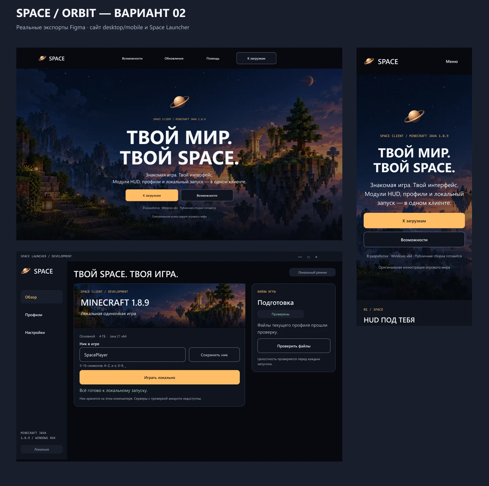

# Orbit v2 — дизайн-предложение Space Client

25 октября 2026 пользователь попросил подачу ближе к Lunar Client, Badlion и Dawn. Созданы редактируемые макеты сайта и desktop Space Launcher в существующем [Figma Design-файле](https://www.figma.com/design/rlT7ixlB1AVZVvp9BfRLZJ/Space-Client-Website-Design). Код сайта/launcher не менялся; текущая реализация остаётся Eclipse. Это следующий вариант для визуального сравнения, а не принятая реализация или публичный релиз.

## Источники и решение

Просмотрены официальные страницы и их первые экраны в браузере:

| Источник | Наблюдение и применение |
|---|---|
| [Lunar Client](https://www.lunarclient.com/) | Игровой мир заполняет hero, бренд и действия собраны в центре. У Space — собственная сцена, выбранный Ringworld и самостоятельный текст. |
| [Badlion](https://www.badlion.net/) | Крупные жирные заголовки, широкие игровые промо и визуальные блоки возможностей. У Space — предметная демонстрация HUD/launcher и новости разработки. |
| [Dawn](https://dawn.gg/) | Большая демонстрация интерфейса, акцентное действие, профили и запуск как основа продукта. У Space — редактируемый product preview и игровая карточка активного профиля. |

Оформление и код конкурентов не копируются. Их FPS-обещания, магазины, друзья, серверы, платформы и числа модулей не приписываются Space. Hero-иллюстрация создана встроенным imagegen: оригинальный блочный мир с парящим островом, каменной аркой, тёмно-синим небом и янтарными фонарями. Она используется отдельной image fill; UI не превращён в плоский bitmap.

ui-ux-pro-max использован для визуального направления. Широкий запрос дал неподходящий Brutalism; уточнение gaming immersive showcase — предметную 3D-подачу. Неоновые цвета, тяжёлый WebGL и social proof из общей рекомендации не применялись. Правила структуры опираются на [Figma auto layout](https://help.figma.com/hc/en-us/articles/360040451373-Guide-to-auto-layout-in-Figma), [variables](https://help.figma.com/hc/en-us/articles/15339657135383-Guide-to-variables-in-Figma) и [типографические роли Material](https://m3.material.io/styles/typography/applying-type).

## Что создано

Две новые страницы: **Orbit · Website** (`43:133`) и **Orbit · Launcher** (`43:1579`). Историческая Page 1 сохранена.

- Сайт: главная, возможности, загрузки, обновления и помощь в 1440/390; статья обновления и инструкция помощи в обоих размерах; mobile menu, empty search, API error и 404. Всего 18 веб-экранов.
- Приложение 1180×760: ready, первый запуск, подготовка, ошибка подготовки, starting/running, ошибки Java/ника, профили с черновиком, настройки. Всего 10 экранов.
- Specimen foundations/controls. Button — 18 variants, Field — 4, Badge — 4, Navigation — 4. 41 variables с semantic aliases/scopes/code syntax и 12 text styles. Segoe UI Bold/Regular/Semibold и Consolas подтверждены desktop Figma.

Ключевые ссылки: [главная desktop](https://www.figma.com/design/rlT7ixlB1AVZVvp9BfRLZJ/Space-Client-Website-Design?node-id=43-201), [главная mobile](https://www.figma.com/design/rlT7ixlB1AVZVvp9BfRLZJ/Space-Client-Website-Design?node-id=43-688), [launcher ready](https://www.figma.com/design/rlT7ixlB1AVZVvp9BfRLZJ/Space-Client-Website-Design?node-id=43-1580), [профили](https://www.figma.com/design/rlT7ixlB1AVZVvp9BfRLZJ/Space-Client-Website-Design?node-id=43-2117), [настройки](https://www.figma.com/design/rlT7ixlB1AVZVvp9BfRLZJ/Space-Client-Website-Design?node-id=43-2186), [controls specimen](https://www.figma.com/design/rlT7ixlB1AVZVvp9BfRLZJ/Space-Client-Website-Design?node-id=43-1471).

Hero «ТВОЙ МИР. ТВОЙ SPACE.» использует display 84/90 и 44/50. Более холодные тёмные поверхности согласованы с янтарным акцентом и игровым изображением. В launcher ник и сохранение находятся рядом; широкая основная кнопка связана с активным профилем. Подготовка и журнал отделены в правую колонку.

## Проверка и сохранность

[Native audit](../qa/figma-orbit-2026-10-25.json): 29 экранов, 2115 nodes, 867 text nodes, 303 component instances, 356 auto-layout frames, 176 prototype edges. `layoutIssues=0`, `textIssues=0`. Это структурная проверка границ и missing-font/нулевой геометрии; она не доказывает доступность будущей реализации. Осмотрены настоящие Figma PNG, включая отдельно полные главные desktop/mobile, launcher ready, controls и обзорные листы остальных экранов. Локальный приближённый renderer не использовался как доказательство Figma-приёмки.

Запись выполнена штатным local development plugin в desktop Figma с `networkAccess:none`: MCP Starter quota оставался исчерпан. [Plugins поддерживаются Starter](https://help.figma.com/hc/en-us/articles/360042532714-Use-plugins-in-files), [desktop development API — официальный путь](https://developers.figma.com/docs/plugins/plugin-quickstart-guide/). Исправлены deprecated `action` на `actions` и переходы на свой же top-level frame; повторная генерация страниц не выполнялась. Team move/upgrade не выполнялись.

Figma сообщала о несинхронизированных локальных изменениях. Облачное наличие новых слоёв пока не подтверждено, поэтому сохранён отдельный [редактируемый FIG](Space-Client-Orbit-v2-2026-10-25.fig), 7 535 210 байт, SHA-256 `7898f83cff5790cb1ba3802e9b137a6ed75751ddd3b13bc8c4c88f8962ae0ec2`. Проверен ZIP-контейнер: canvas.fig, meta.json, thumbnail.png и 6 изображений; оригинальный новый фон включён с длиной 2 208 429 байт. Старый FIG не перезаписывался. Полные PNG, исходник локального плагина и пакет исследования сохранены в outputs дизайн-чата.

Сайт честно показывает отсутствие публичной сборки; Space-регистрация и официальный Microsoft-вход не изображены готовыми. Running означает процесс, а не готовность мира. Прогресс и профиль в макете — примеры. Prototype timeout 1.2 s иллюстрирует последовательность и не является измерением запуска.

SC-17 не закрывается автоматически: остаются выбор пользователем нового направления, подтверждение облачной синхронизации и дальнейшая приёмка по критериям issue. Тесты продукта/веб-AT/Safari/hosting этим дизайном не заменяются.
